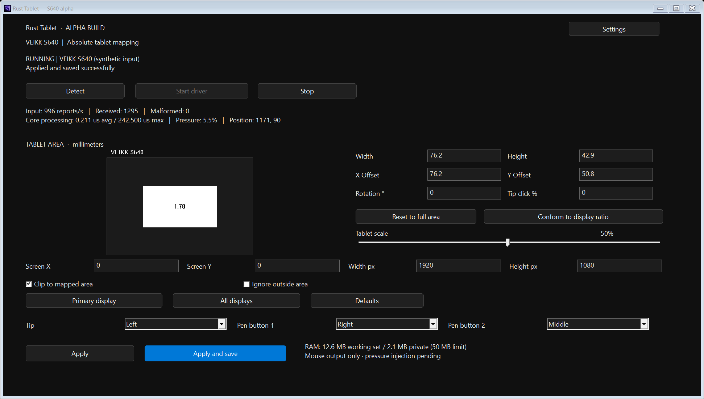

# OpenTabletDriver Rust pre-release

This branch contains an experimental native Rust implementation of OpenTabletDriver, focused on low memory use and responsive tablet input.

> **Windows x64 pre-release · VEIKK S640 only.** The Rust app has not yet been validated with other tablets. The repository's upstream tablet configurations and parser sources are retained as migration references; their presence does not mean they are supported by this Rust app.



## Build and preview

Install Rust 1.88 or newer, then run from PowerShell:

```powershell
cd rust
cargo build --release --locked
.\target\release\otd-rust-ui.exe --simulate
```

Simulation does not connect to the tablet or move the pointer. Read [the Rust app guide](rust/README.md) for hardware use, settings, memory measurements, and current limitations.

## Tablet migration references

`OpenTabletDriver.Configurations/Configurations` retains upstream device profiles. `OpenTabletDriver.Configurations/Parsers` retains upstream parser implementations as reference material while they are ported and tested in Rust. Profiles and parser sources are not wired into the Rust app except for the VEIKK S640 configuration.

## License and attribution

This fork retains the upstream [LGPL-3.0 license](LICENSE), tablet configuration data, and parser sources. The Rust migration and its tests were created with AI assistance.
